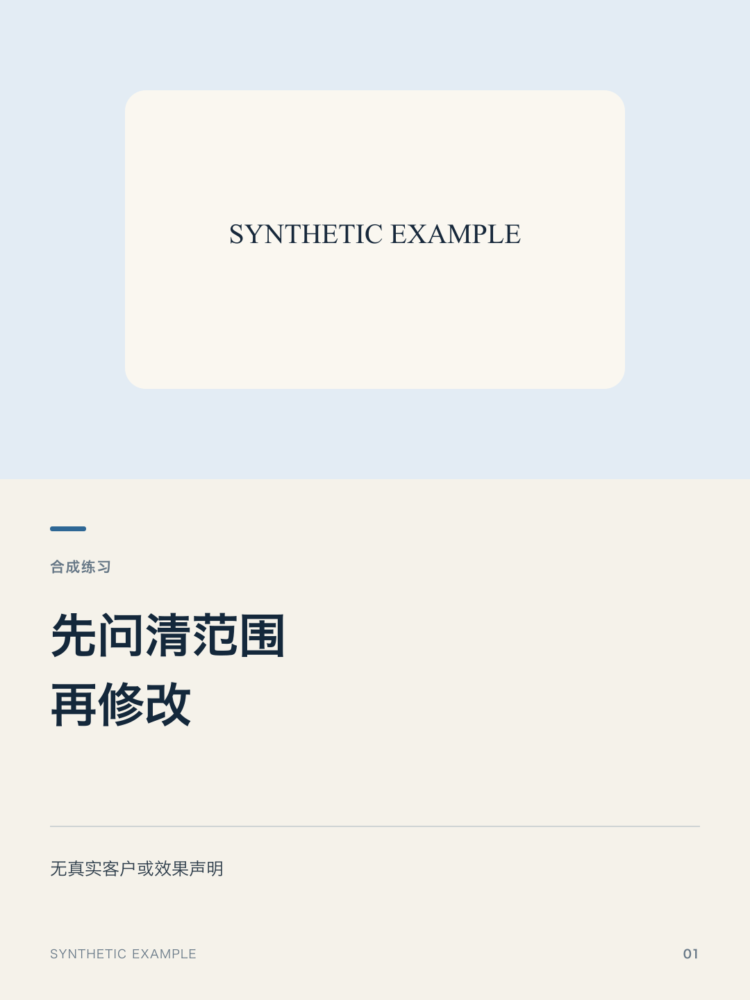

# 小红书图文 Skill

版本：0.1.0 独立用户版。按本项任务单独使用，不要求安装合集或作者的经营系统。

## 适用和材料写法

需要：已确认逐页文字或结构、封面承诺及兑现页、正文、授权素材和输出目录。分清纯文字图文与模型/要素关系图；文字脚本需用户图片。可先用完整合成材料跑通，不借私人照片，不自动改内容事实。材料可粘贴或放自己的工作目录，明确已确认内容与待定事项；缺项只补会改变本次结果的部分。

完整合成练习（不代表真实客户或传播效果）：

> 用 $hanxu-xiaohongshu-visual：合成练习：封面承诺是先问清范围再修改。正文依次为：客户说改一点，不一定只是换一句话。先问位置与目的，才能判断影响范围。发现牵动整页结构时，先确认范围与时间，再动手。按包内示例生成完整图片、缩略图及联系表，保持段落，不上传。

## 安装与使用

取得完整 hanxu-xiaohongshu-visual 文件夹后交给能读取Skill的AI助手安装，保留配套文件。旧版先备份到技能发现目录外，用户素材与结果单独保存；让助手读回名称、0.1.0版本及实际位置，未识别时按宿主说明恢复。

文字渲染需Node.js、Sharp和中文字体，先运行 npm install。模型图另需实际可用的图形/生成工具，纯文字脚本不支持任意模型图。

完整合成输入在examples/；图片是明确标注的合成几何图，不是本人或客户素材。在技能目录运行：

    node scripts/render_xhs_full_article.mjs examples/config.json

示例的objectDir/sourcePath/photoPath相对当前技能目录；实际使用换自己的路径，revision用简单新版本名。默认不覆盖已有导出和源文件，明确replace才替换。

## 安装包与结果

包内包括：SKILL.md、scripts/render_xhs_full_article.mjs、package.json、examples/config.json、examples/source.txt、examples/synthetic-image.svg、agents/openai.yaml及版本/校验文件。SKILL.md和配套方法通常不用修改；示例复制到自己的工作目录后换真实材料，安装依赖不等于素材已授权。

得到：1080×1440整套PNG、270×360封面缩略图、联系表、可编辑SVG、源文对照与顺序。图片成品要打开最终文件检查，返修后重查同版本，不混交旧图。未具备渲染工具时说明真实阶段，不把文案或结构当成图片。

## 费用、资料与限制

模型、渲染及外部工具费用按自己的账号实际承担；不自动购买、发送、上传或发布。使用选择的AI服务处理材料，文件存自己的目录，包内不带作者私人照片、声音或客户资料。

本版实际验证范围见 VALIDATION.md；不保证真人采用、点击率、阅读量或商业效果。模型图的具体工具与产出须逐任务核对。反馈用版本、去敏材料及具体问题，不交凭据或完整私人库。

未设正式开源许可证；公开可下载不自动授予再分发或转售权利。

## 本版验证

见[验证范围与已知限制](VALIDATION.md)。技术和合成演练不代表真实用户采用或经营效果。

## 下载与源码

[GitHub源码](https://github.com/hanxu66/hanxu-xiaohongshu-visual) · [本版ZIP](https://github.com/hanxu66/hanxu-xiaohongshu-visual/releases/download/v0.1.0/hanxu-xiaohongshu-visual-v0.1.0.zip)。下载后解压完整目录，按上面的输入示例开始。

## 练习得到的实际结果

以下结果来自本轮明确合成材料，不是客户效果或外部用户认可。

合成正文3段57字符，实际生成封面和内页共2张1080×1440图片，并保留源文顺序、SVG、缩略图和联系表。以下是实际导出：

页眉缺省已修复，不显示undefined。仅此纯文字路径经过本轮实跑，不能据此声称任意模型图或Windows字体已验证。
